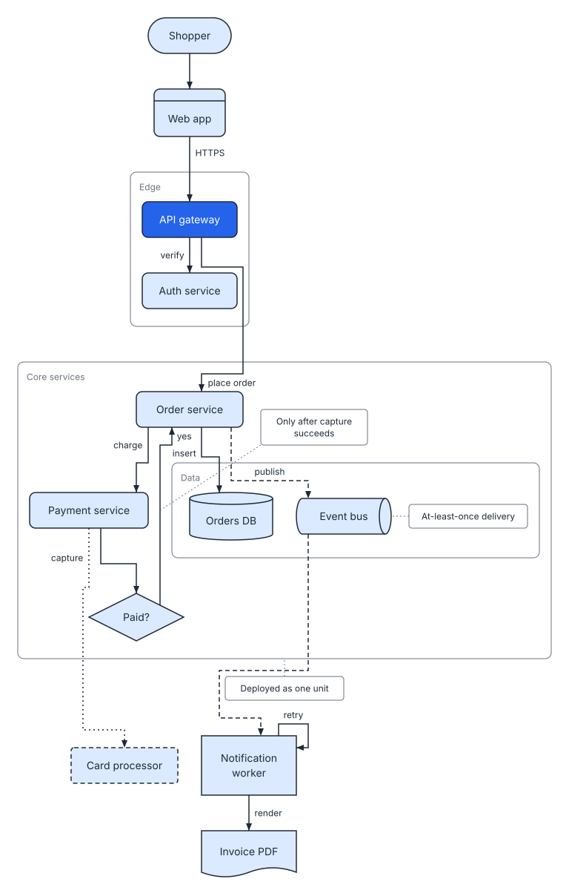
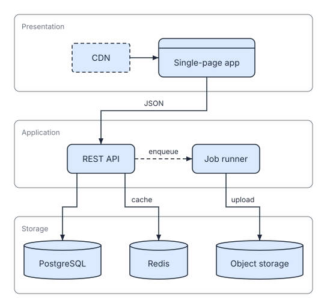
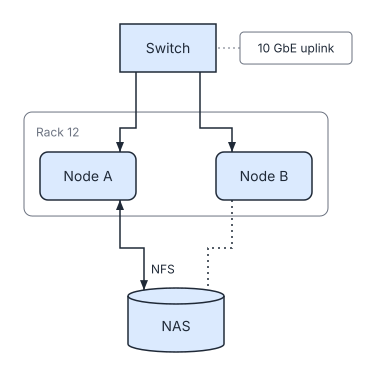

# Layout and auto-fit

SVGDog decides where every box goes. This chapter describes how the four diagram types are placed, what the 8 px grid means, and how auto-fit tries to keep a drawing within `max_width` before giving up with `too-wide`. The code is in `src/render/layout.rs`, `src/render/sequence.rs` and `src/render/mod.rs`.

## The grid and the constants

Everything lands on an 8 px grid. The sizes that matter to an operator:

| Constant | Value | Meaning |
| --- | --- | --- |
| `GAP` | 32 px | Space between neighbouring boxes in a stack |
| `RANK_GAP` | 48 px | Space between ranks, the columns (or rows) of a flow |
| `PAD` | 16 px | Padding inside a group frame |
| `PAD_LABEL` | 40 px | Top padding of a frame that has a label |
| `RESERVE` | 8 % | Extra width kept on text in case the reader's machine substitutes a different font |

Node sizes come from the measured label text (Inter at 14 px) and the node kind. Boxes grow in 16 px steps and have kind-specific minimums, for example 96 x 48 for a plain box and 128 x 64 for a decision (`measure`, `src/render/layout.rs:90-120`). A node can fix its own `width` (at least 40), which also sets where its label wraps.

## The four diagram types

### flow

Boxes are arranged in ranks along the main direction, `right` (default) or `down`. Cycles are broken by a depth-first search: an edge back to a box still on the search stack is treated as running forward, so the ranking is always finite (`layered`, `src/render/layout.rs:223`). Groups are laid out inside out: a group is sized from its members first, then placed as one block. Edge anchors, not box centres, are lined up across ranks, which is what keeps edges straight.



### layers

Top-level groups become full-length bands stacked across the flow. Nodes outside any group share a first band without a frame. Every band is stretched to the same length and its contents are re-centred, so the figure reads as tiers.



### sequence

Nodes become lifelines side by side, in the order they appear in the spec, except that the members of a top-level group stay together as a block (`order`, `src/render/sequence.rs:12-37`). Edges become messages listed top to bottom in spec order, 40 px apart. A message from a node to itself is drawn as a 32 px wide loop and takes 56 px of height (`STEP` and `LOOP`, `src/render/sequence.rs:11-12`).


### free

Boxes are pinned at the `at: [x, y]` position you give, snapped to the grid. Frames wrap their members with padding, and notes sit beside their targets. Use it for physical layouts such as a rack, where position is the point.



## Notes

A note reserves room beside the box, group or edge it points at (`side`: `right` by default, or `top`, `bottom`, `left`) and is joined to it by a short dotted leader line. Notes are included in the size that auto-fit measures.

## Auto-fit

`max_width` is the widest the drawing may be, in px. It defaults to 960 and must be 200 to 2000. Render does not squash text to fit; it tries three levels of tightness, roomiest first, and stops at the first one that fits (`LEVELS` in `src/render/layout.rs:28`, loop in `render`, `src/render/mod.rs:554-573`):

| Level | Node label wraps at | Note wraps at | Room beside an edge label |
| --- | --- | --- | --- |
| 1 (roomiest) | 160 px | 168 px | 32 px |
| 2 | 120 px | 136 px | 24 px |
| 3 (tightest) | 88 px | 104 px | 16 px |

Tighter levels wrap labels earlier, so boxes get taller and narrower. The drawing is chosen only on width; height is not limited.

### When it still does not fit: `too-wide`

If even level 3 is wider than `max_width`, render stops with exit code 3 and the error code `too-wide`, for example:

```text
error[too-wide]: The drawing is 576 px wide even at the tightest spacing; max_width allows 300.
  Try 'direction: down', shorter labels, or a larger max_width.
```

The suggestion depends on the diagram: for a left-to-right flow or layers diagram it recommends `direction: down`; otherwise it recommends shorter labels, fewer boxes side by side, or a larger `max_width`. Nothing is written to the output path. See [Troubleshooting](../operations/troubleshooting.md).

### The canvas

After placement the canvas is fitted to what was drawn. The margin is the widest of 24, 16 or 8 px that keeps the empty margin to at most 13 % of the dimension, safely under the 15 % at which the `excess-margin` rule fires, so small diagrams get small margins (`fit`, `src/render/mod.rs:450-470`). The result is the `viewBox` of the SVG.
