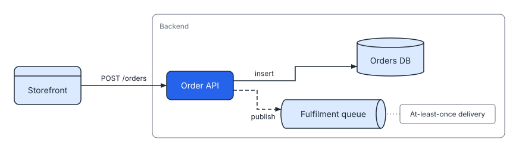

# System overview

SVGDog is a single Rust binary that does three things to SVG: it creates a diagram from a spec, checks any SVG against a rule catalogue, and changes an SVG or a spec in a controlled way. This chapter shows how those paths fit together so that later chapters can zoom in.



The picture above is the kind of output the create path produces. It was rendered from `tests/fixtures/orders.yaml` and is byte-for-byte the golden file in `tests/golden/orders.svg`.

## The three paths

| Path | Commands | What goes in | What comes out |
| --- | --- | --- | --- |
| Create | `render` | A YAML or JSON spec | An SVG, plus findings about it |
| Check | `validate`, `inspect`, `preview` | Any SVG | Findings, element data, or a PNG |
| Change | `edit`, `fix` | An SVG, or a spec (for `edit`) | The changed file, a diff, and the findings that remain |

`schema`, `rules` and `mcp` are support commands: the first two print what SVGDog accepts and checks, and `mcp` serves all of the above to an agent over stdio.

Every command prints one result object, the *envelope*, described in [Envelope and exit codes](../reference/envelope-exit-codes.md). The text form that a terminal gets by default is a rendering of the same data.

## Modules behind each path

```text
cli.rs ── main.rs ── commands/*.rs ─┬─ spec.rs → render/{layout,route,sequence,mod}.rs   (create)
                                    ├─ rules/*.rs + catalogue.rs + config.rs             (check)
                                    ├─ svg/*.rs (parser, styles, text metrics, selector) (check, change)
                                    ├─ ops.rs, spec_edit.rs, yaml_patch.rs, diff.rs      (change)
                                    └─ preview.rs (resvg rasteriser)                     (preview)
mcp.rs wraps the same commands as tools.
```

- **`src/cli.rs`** declares the arguments with clap. **`src/main.rs`** parses them, picks the output format, runs one command and turns any failure into the error envelope. A panic anywhere is caught and reported as exit code 5 instead of a backtrace (`src/main.rs:185-198`).
- **`src/spec.rs`** reads and validates a spec ([next chapter](spec-pipeline.md)). **`src/render/`** turns it into SVG text ([layout](layout.md), [routing](routing.md)).
- **`src/svg/`** is SVGDog's own view of an SVG file: a parsed tree plus resolved styles, text measurements and element boxes (the *scene*). The rules, `inspect`, `edit` and `preview --crop` all work from the scene.
- **`src/rules/`** holds the 38 rule implementations in four files (structure, geometry, portability, accessibility). **`src/catalogue.rs`** is the metadata for each rule: id, group, default severity, autofix level, options and the failing and passing examples that `svgdog rules --explain` prints.
- **`src/config.rs`** finds and parses `svgdog.toml` and resolves which rules are on, and at what severity, for each file.
- **`src/ops.rs`** applies edit operations by patching text, so bytes outside the targeted elements stay as they were. **`src/spec_edit.rs`** and **`src/yaml_patch.rs`** do the same for specs, keeping comments where they can.
- **`src/preview.rs`** rasterises with resvg using only the bundled Inter and JetBrains Mono fonts, so no system font can change the picture.

## What SVGDog never does

It does not open a network connection, launch a browser, run a script found in an SVG, or read a file you did not name (apart from `svgdog.toml`, which it looks for by walking up from the input file). It writes only where you tell it to, by writing a temporary file beside the target and renaming it, so a failed write never leaves half a file (`src/commands/change.rs:57-64`).

## Where to go next

- To see how a spec becomes a checked diagram, read [From spec to validated spec](spec-pipeline.md).
- To see how the rules run, read [The rule engine](rules-engine.md).
- To look up commands and flags, read the [command reference](../reference/commands.md).
