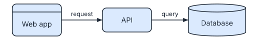
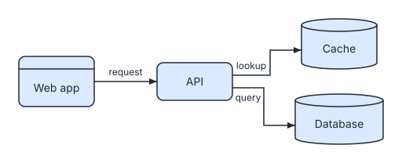

# 1. Your first diagram

**Level: simplest.** You write a few lines of text, SVGDog draws and checks the picture, and you look at the result. Five minutes.

This is the base of everything else: a **spec** (a small YAML file) is the source, the **SVG** is a build product, and you never edit the SVG by hand.

## The workflow at a glance

```text
hello.yaml  --render-->  hello.svg  --preview-->  hello.png
 (you edit)             (checked)                (you look)
```

## 1. Write the spec

Create `hello.yaml`. Every spec needs `version: 1`, a `diagram` type, a `title` and at least one node. The `description` is optional but worth writing: it becomes the text a screen reader speaks for the picture.

```svgdog hello
version: 1
diagram: flow
title: Hello pipeline
description: A web app calls an API, which queries a database.
nodes:
  - {id: web, label: Web app, kind: client}
  - {id: api, label: API, kind: service}
  - {id: db, label: Database, kind: datastore}
edges:
  - {from: web, to: api, label: request}
  - {from: api, to: db, label: query}
```



The picture above was drawn from exactly that spec. You do not place anything: SVGDog lays the boxes out on a grid and routes the arrows around them.

> **Tip.** Not sure where to start? `svgdog examples` lists nine bundled specs that cover all seven diagram types, and `svgdog examples flow` prints one to copy.

## 2. Render it

```bash
svgdog --format text render hello.yaml -o hello.svg
```

```text
Wrote hello.svg (1790 bytes).

1 file checked: 0 errors, 0 warnings, 0 info, 0 fixable
```

`render` does two jobs in one call: it draws the diagram and **checks its own work** against the rules (contrast, text size, arrows that touch their boxes, accessibility text and more). The exit code is `0` when nothing is wrong and `1` when a finding reaches the fail level, so you can use it in a script without reading any output.

The same spec always gives the same bytes. SVGDog does not overwrite a file unless you say so: a second run onto `hello.svg` stops with exit code 4 (`output-exists`). Add `--force` to replace it, and the file you get is byte for byte the one you had.

## 3. Look at it

A check can pass and a picture can still be confusing, so look at it:

```bash
svgdog --format text preview hello.svg -o hello.png
```

```text
Wrote hello.png (1200 x 191 px, 15710 bytes).
```

Open `hello.png`. If a label is cramped or an arrow is in the wrong place, change the spec and render again with `--force`. That edit, render, look loop is the whole workflow.

## 4. Change it

Add a cache between the API and the database. Edit the spec, not the SVG:

```yaml
nodes:
  - {id: web, label: Web app, kind: client}
  - {id: api, label: API, kind: service}
  - {id: cache, label: Cache, kind: datastore}
  - {id: db, label: Database, kind: datastore}
edges:
  - {from: web, to: api, label: request}
  - {from: api, to: cache, label: lookup}
  - {from: api, to: db, label: query}
```

Render again, replacing the old picture:

```bash
svgdog --format text render hello.yaml -o hello.svg --force
```

The result:

<!-- svgdog hello-cache
version: 1
diagram: flow
title: Hello pipeline with a cache
description: A web app calls an API, which looks in a cache and queries a database.
nodes:
  - {id: web, label: Web app, kind: client}
  - {id: api, label: API, kind: service}
  - {id: cache, label: Cache, kind: datastore}
  - {id: db, label: Database, kind: datastore}
edges:
  - {from: web, to: api, label: request}
  - {from: api, to: cache, label: lookup}
  - {from: api, to: db, label: query}
-->



Because the spec is the source, you can keep it in Git and review the change as a two-line diff instead of a thousand-line SVG diff.

## What you learned

| You did | With |
|---|---|
| Described a diagram as data | a YAML spec |
| Drew and checked it in one step | `svgdog render` |
| Saw the result | `svgdog preview` |

**Next:** you now have a pipeline for diagrams you draw. [Workflow 2](2-check-any-svg.md) covers the opposite case: an SVG somebody else made.
