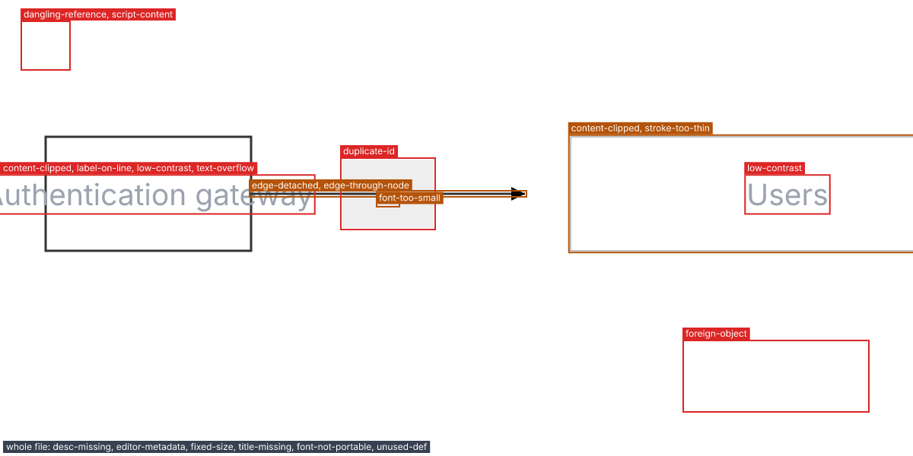
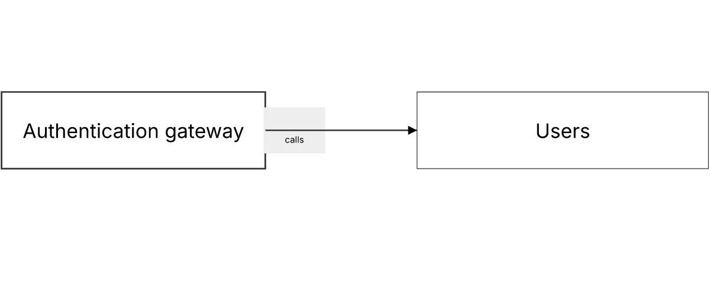

# 2. Check an SVG you did not make

**Level: easy.** You have an SVG from a design tool, a colleague or an old repository, and you want to know if it is safe and readable before it goes into your documentation. SVGDog does not need a spec for this: it checks any SVG. Ten minutes.

## The workflow at a glance

```text
legacy.svg --validate--> findings --fix--> legacy-fixed.svg --validate--> clean?
                              \--preview --annotate--> where the problems are
```

The examples use `tests/fixtures/broken.svg` from the SVGDog repository, a small diagram with deliberate problems. Use any SVG you have instead.

## 1. Find the problems

```bash
svgdog --format text validate broken.svg
```

```text
      3  warning  desc-missing        svg  The root <svg> has no <desc> saying what the diagram shows.
      3  info     editor-metadata     svg  The file holds editor namespaces (inkscape), 1 generator comment. [fix]
      3  warning  fixed-size          svg  The root sets width="400" and height="200", so the image cannot scale to the page. [fix]
      3  error    title-missing       svg  The root <svg> has no <title>; it is the image's accessible name.
     14  error    low-contrast        #a > text  Text #9ca3af on #ffffff (#a > rect) has contrast 2.54:1; the minimum is 4.5:1. [fix --unsafe]
     23  error    script-content      svg > rect:nth-of-type(2)  Event handler attribute 'onclick' carries script. [fix]
     24  error    foreign-object      svg > foreignObject  <foreignObject> content is dropped by many PDF and image pipelines.
     ... (more lines)

1 file checked: 7 errors, 11 warnings, 2 info, 15 fixable
```

Each line gives the line number, the severity, the **rule** that was broken, **where** in the file (a selector you can use later) and a message that says what to do. `[fix]` means SVGDog can repair it without moving or recolouring your content; `[fix --unsafe]` means the repair would move or recolour something, so you must ask for it.

The exit code is `1` here because there are errors. Warnings and info do not fail a run unless you ask: `--fail-on warning`.

> **Tip.** Want to know why a rule exists? `svgdog rules --explain low-contrast` prints a failing example, a passing one and the fix.

## 2. See where they are

Words are hard to match to a picture. Outline the problems on a PNG:

```bash
svgdog --format text preview broken.svg -o broken-annotated.png --annotate
```

```text
Wrote broken-annotated.png (1200 x 600 px, 30212 bytes).
8 finding boxes outlined.
```



`--crop` zooms in on one finding when a box is too small to see.

## 3. Apply the safe fixes

```bash
svgdog --format text fix broken.svg -o broken-fixed.svg
```

SVGDog lists what is left and ends with:

```text
1 file checked: 6 errors, 3 warnings, 0 info, 4 fixable
```

The original file is untouched: `-o` writes a copy. Use `--in-place` when you want to change the file itself, and `--dry-run` to see the diff without writing anything.

The 20 findings became 9. The safe fixes cleared the editor leftovers, the unused definition, the fixed size, clipped content, hairline strokes, a detached arrow end and the script attribute. They also widened the left box to fit its label and moved the arrow's start out to the new edge. Safe fixes never move or recolour your content, though a box may grow to hold its text. The 4 that SVGDog still calls fixable all need `--unsafe`.

## 4. Decide about the rest

What is left needs a human or a deliberate choice:

| Finding | Why it was not fixed | What to do |
|---|---|---|
| `title-missing`, `desc-missing` | Only you know what the picture shows | Add a `<title>` and `<desc>` |
| `low-contrast` | Fixing it recolours the text | Run with `--unsafe`, or choose the colour yourself |
| `dangling-reference` | The file points at something that does not exist | Remove the reference or add the target |
| `foreign-object` | Its content may vanish in some pipelines | Redraw that part as plain shapes |

When you are happy to let SVGDog move and recolour, preview the change first:

```bash
svgdog fix broken-fixed.svg --unsafe --dry-run
```

```text
1 file checked: 3 errors, 2 warnings, 0 info, 0 fixable
```

That leaves only what needs a person: the missing reference, the `foreignObject`, the missing title and description, and the font fallback. When the diff looks right, write it:

```bash
svgdog fix broken-fixed.svg --unsafe --in-place
```

Look at the picture again with `preview` afterwards:

```bash
svgdog --format text preview broken-fixed.svg -o broken-fixed.png
```



Compare it with the annotated picture above. The labels are readable, the text fits, nothing is cut off and the arrow joins the two boxes. Still check it yourself: a clean report is not the same as a good picture, and the small grey label box now touches the left box.

## 5. Confirm

```bash
svgdog --format text validate broken-fixed.svg
```

```text
1 file checked: 3 errors, 2 warnings, 0 info, 0 fixable
```

The exit code is still `1`, and that is the honest answer: three errors are left that no tool can repair for you. `fix` exits `1` for the same reason whenever findings remain. Add the title and description, remove the dangling reference and redraw the `foreignObject` part by hand, then validate again. Exit code `0` means the file is clean at the strictness you asked for.

## Choosing how strict to be

SVGDog has three profiles, set with `--profile` or in a config file (see [workflow 5](5-agents-and-ci.md)):

| Profile | Checks | Use it for |
|---|---|---|
| `minimal` | Only whether the file is valid and safe | Pictures from tools you cannot change |
| `docs` | Everything, at normal severity (default) | Documentation |
| `strict` | Everything, with every level raised one step | Releases and shared style libraries |

On the broken file the three profiles report 3, 7 and 10 errors.

## What you learned

| You did | With |
|---|---|
| Listed the problems | `svgdog validate` |
| Located them on the picture | `svgdog preview --annotate` |
| Repaired what is safe | `svgdog fix` |
| Chose a strictness | `--profile` |

**Next:** repeating this by hand does not scale to a whole documentation site. [Workflow 3](3-diagrams-in-pages.md) puts the diagrams inside the pages themselves.
