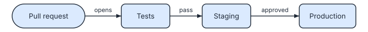

# 3. Diagrams that live in your pages

**Level: intermediate.** In workflows 1 and 2 the spec and the SVG were separate files you had to keep in step. Here the spec lives **inside the Markdown page** that shows it. SVGDog draws the picture, writes the image line under it and keeps both current. Ten minutes.

This is the workflow for documentation: the text and its diagram are one file, reviewed and changed together.

## The workflow at a glance

```text
page.md (text + spec)  --svgdog docs-->  page.md (+ image line)  +  diagrams/page-name.svg
                       --svgdog docs --check-->  exit 1 if anything is out of date
```

## 1. Put the spec in the page

Write the diagram in a code block marked `svgdog`, in the middle of your prose. This is a real one, taken from the source of this page:

```svgdog deploy
version: 1
diagram: flow
title: Release path
description: A change goes from a pull request through tests to production.
nodes:
  - {id: pr, label: Pull request, kind: actor}
  - {id: tests, label: Tests, kind: service}
  - {id: staging, label: Staging, kind: service}
  - {id: production, label: Production, kind: service}
edges:
  - "pr -> tests: opens"
  - "tests -> staging: pass"
  - "staging -> production: approved"
```



The word after `svgdog` (`deploy`) names the picture. Without it, diagrams are numbered in the order they appear.

## 2. Draw the pictures

```bash
svgdog docs docs/
```

SVGDog finds every `svgdog` block in the Markdown files under `docs/`, draws each one into a `diagrams` folder **next to the page** and adds an image line under the block:

```markdown

```

The square-bracket text is the alt text readers get when the picture cannot be shown. SVGDog writes it from the spec's `title` and `description`, so a page is accessible by default. You can pass single files too: `svgdog docs README.md docs/`.

Run the same command when nothing changed and nothing is written. Change the spec and the picture and the image line are updated. Boxes that were already in the picture stay where they were, so a one-word edit does not rearrange the diagram (see [workflow 4](4-explain-and-change.md)).

## 3. Show the picture, not the source

A code block shows its YAML to readers. If they should see only the picture, put the spec in a comment instead:

```markdown
<!-- svgdog deploy
version: 1
diagram: flow
title: Release path
nodes:
  - {id: pr, label: Pull request}
  - {id: tests, label: Tests}
edges:
  - "pr -> tests: opens"
-->
```

The opening `<!-- svgdog` and the closing `-->` each sit on a line of their own. In a tutorial, keep the code block; in a product page, hide it.

## 4. One picture for light and dark pages

Sites such as GitHub show a page in the reader's light or dark mode. Ask for the picture that follows the reader:

```bash
svgdog docs docs/ --theme docs-auto
```

It is one file: the light drawing with a rule inside that switches to dark colours in dark mode.

## 5. Make CI keep them honest

The last step is what makes this a workflow rather than a habit. Add the check to your pull request job:

```bash
svgdog docs docs/ --check
```

`--check` writes nothing. It exits `1` if any picture is missing, out of date, or no longer what its spec renders. A writer who edits a spec and forgets to redraw gets a red build, and a reviewer never has to ask "did you regenerate the image?".

The SVGDog repository does this on its own documentation. Its build runs `svgdog docs docs/guide README.md --check`, which covers every diagram written as a block in its guides, including the ones in this show room.

> **Tip.** Commit the generated SVGs. Readers on GitHub or GitBook see the pictures without running anything, and the `--check` step proves they match the spec.

## Interactive versions

Add `--interactive html` and SVGDog also writes a small page per diagram with step controls, and ends the image line with a link to it. Use `--interactive css` for pictures that highlight a box and its arrows on hover wherever the page inlines the SVG.

## What you learned

| You did | With |
|---|---|
| Wrote the diagram where it belongs | a `svgdog` block in the page |
| Drew every diagram in a folder | `svgdog docs docs/` |
| Kept them honest | `svgdog docs docs/ --check` in CI |

**Next:** pictures that stay correct are good. [Workflow 4](4-explain-and-change.md) makes them tell a story, and makes changes cheap.
