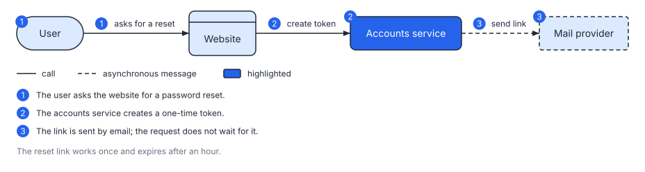
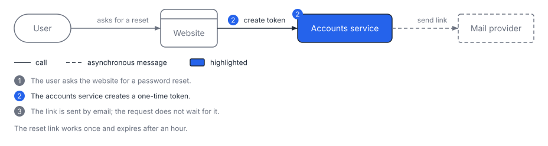
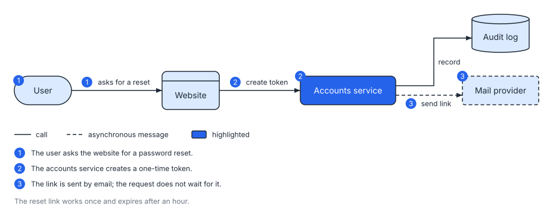

# 4. Explain it, then change it safely

**Level: advanced.** A diagram that is read by many people and changed over many months needs two things: it should explain itself, and it should survive edits without rearranging. This workflow covers both. Fifteen minutes.

## The workflow at a glance

```text
spec with steps --render--> story + alt text   --describe--> words for the page
spec edited     --render --previous--> same layout, new box added
SVG             --edit--> one attribute changed by id (no spec needed)
```

## 1. Tell the story, not only the structure

A spec can carry the explanation. `steps` number a walk-through and list it under the drawing, `focus` dims everything else, `legend` and `caption` add the words a figure needs, and `detail` and `link` give tooltips and links. This is the bundled `steps` example (`svgdog examples steps`), which uses all of them except `focus`:

```svgdog reset
version: 1
diagram: flow
title: Password reset
description: How a password reset request becomes a new password.
caption: The reset link works once and expires after an hour.
legend: true
nodes:
  - { id: user, label: User, kind: actor }
  - { id: site, label: Website, kind: client }
  - { id: accounts, label: Accounts service, kind: service, emphasis: true, detail: Creates and checks reset tokens. }
  - { id: mail, label: Mail provider, kind: external, link: "https://example.com/mail" }
edges:
  - "user -> site: asks for a reset"
  - "site -> accounts: create token"
  - "accounts --> mail: send link"
steps:
  - { text: The user asks the website for a password reset., show: [user, user--site] }
  - { text: The accounts service creates a one-time token., show: [accounts, site--accounts] }
  - { text: The link is sent by email; the request does not wait for it., show: [accounts--mail, mail] }
```



Three more outputs come from the same spec:

```bash
svgdog render reset.yaml -o reset.svg --frames
```

writes one picture per step (`reset.1.svg`, `reset.2.svg`, `reset.3.svg`), each with that step in focus, for slides or a tutorial. This is `reset.2.svg`:



```bash
svgdog render reset.yaml -o reset.html --interactive html
```

writes a page with step controls, and `--interactive css` makes the SVG itself highlight on hover.

## 2. Say it in words

Every diagram needs a text alternative, and one you write by hand drifts from the picture. Ask SVGDog to read the spec back:

```bash
svgdog --format text describe reset.yaml
```

```text
Password reset (flow diagram, left to right)
How a password reset request becomes a new password.

Nodes:
- User (actor)
- Website (client)
- Accounts service (service, highlighted) - Creates and checks reset tokens.
- Mail provider (external)

Connections:
- User to Website (asks for a reset)
- Website to Accounts service (create token)
- Accounts service to Mail provider (send link) [asynchronous]

Steps:
1. The user asks the website for a password reset.
...
```

For a short alt text, add `--short`:

```text
Flow diagram: User to Website (asks for a reset); Website to Accounts service (create token); Accounts service to Mail provider (send link).
```

`describe` also reads an SVG, as long as it was rendered with `--embed-spec`, which stores the spec inside the file. That is how an SVG in a folder can still be read, explained and changed years later.

## 3. Change the spec without moving the boxes

First render the picture once. `--embed-spec` stores the spec inside the SVG:

```bash
svgdog --format text render reset.yaml -o reset.svg --embed-spec
```

Now add an audit log to `reset.yaml`: one node and one edge.

```yaml
nodes:
  # ... the four nodes from before, then:
  - { id: audit, label: Audit log, kind: datastore }
edges:
  # ... the three edges from before, then:
  - "accounts -> audit: record"
```

A normal re-layout could shuffle every box; readers who know the old picture would have to learn it again. Hand SVGDog the previous picture and it keeps what was there:

```bash
svgdog --format text render reset.yaml -o reset.svg --previous reset.svg --embed-spec
```

```text
Wrote reset.svg (6718 bytes).

Layout kept: 4 boxes in place, 1 added (audit).
1 file checked: 0 errors, 0 warnings, 0 info, 0 fixable
```

This is the file it wrote. The four original boxes keep the arrangement they have in the picture at the top of this page, with the same order and spacing. The drawing grew upwards to make room for the audit log:



Run it again with no change and the result is `Layout kept: 5 boxes in place.` Removing a box works the same way (`Layout kept: 3 boxes in place, 2 gone.`). If a change cannot be made without moving a box that is staying, SVGDog stops and says so; add `--force` to lay out afresh. Inside Markdown pages `svgdog docs` does this for you automatically.

## 4. Change one thing in an SVG

Sometimes you just need a different colour on one box. No spec is needed: `edit` changes elements by the ids you saw in the findings or in `svgdog inspect`.

```bash
svgdog --format text edit reset.svg --set '#node-accounts > rect.stroke=#dc2626' --dry-run
```

```diff
-    <rect x="504" y="128" width="160" height="48" rx="8" fill="#2563eb" stroke="#1f2937" stroke-width="1.5"/>
+    <rect x="504" y="128" width="160" height="48" rx="8" fill="#2563eb" stroke="#dc2626" stroke-width="1.5"/>
```

`--dry-run` shows the diff and the result of the checks without writing. Remove it and add `-o out.svg` (a copy) or `--in-place`. After every edit SVGDog runs the rules again, so you cannot quietly break the picture. For several changes at once, `--ops ops.json` takes a list of operations: set, remove, move, rename-id and add-node. `svgdog schema ops` prints the format.

> **Tip.** Prefer changing the spec when you have one: the next `render` would undo an edit made only to the SVG. Use `edit` for SVGs you did not generate, or when the file is the only source.

## 5. Know when a render is stale

```bash
svgdog render reset.yaml -o reset.svg --embed-spec --check
```

`--check` writes nothing and exits `1` if the file is missing or is not what this spec renders now. Use the same flags you rendered with, or the file will correctly count as different.

## What you learned

| You did | With |
|---|---|
| Explained the diagram inside the diagram | `steps`, `caption`, `legend` |
| Produced a step-by-step set, a page or a hover version | `--frames`, `--interactive` |
| Generated alt text and a prose description | `svgdog describe` |
| Edited without a reshuffle | `render --previous` |
| Made a one-off change safely | `svgdog edit` |

**Next:** all of this still depends on someone running the commands. [Workflow 5](5-agents-and-ci.md) hands them to your pipeline and to an AI agent, with house rules.
