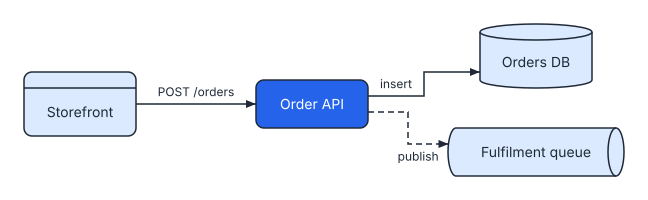
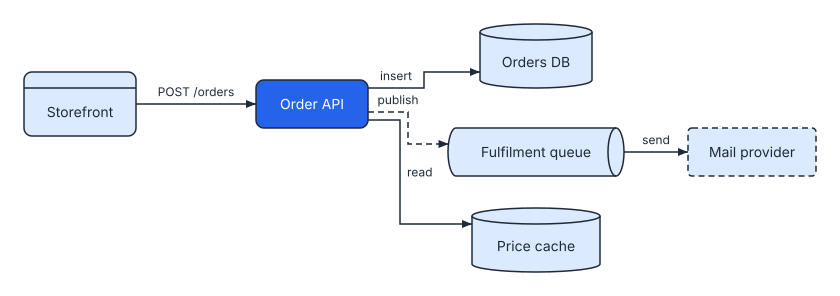

# Changing a diagram without moving it

When you change a spec and draw it again, SVGDog normally arranges the whole diagram from the start. One new box can then move every other box, and a reader who knew the old picture has to find everything again.

You can ask SVGDog to keep the picture your readers know. Give it the SVG it drew last time, and the boxes that are in both versions stay where they were.

## Draw it again over the old picture

```bash
svgdog render orders.yaml -o orders.svg --previous orders.svg
```

`--previous` names the picture drawn from the earlier spec. It can be the file you are writing to, as here; SVGDog then replaces it and you do not need `--force`.

This is a diagram before a change:

```svgdog before
version: 1
diagram: flow
title: Order placement
nodes:
  - { id: web, label: Storefront, kind: client }
  - { id: api, label: Order API, kind: service, emphasis: true }
  - { id: db, label: Orders DB, kind: datastore }
  - { id: queue, label: Fulfilment queue, kind: queue }
edges:
  - "web -> api: POST /orders"
  - "api -> db: insert"
  - "api --> queue: publish"
```



Two boxes and two arrows are added to the spec. Drawn over the old picture, it becomes:

```svgdog after
version: 1
diagram: flow
title: Order placement
nodes:
  - { id: web, label: Storefront, kind: client }
  - { id: api, label: Order API, kind: service, emphasis: true }
  - { id: db, label: Orders DB, kind: datastore }
  - { id: queue, label: Fulfilment queue, kind: queue }
  - { id: cache, label: Price cache, kind: datastore }
  - { id: mailer, label: Mail provider, kind: external }
edges:
  - "web -> api: POST /orders"
  - "api -> db: insert"
  - "api --> queue: publish"
  - "api -> cache: read"
  - "queue -> mailer: send"
```



The four boxes that were there have not moved. The new boxes were put into free room near the boxes they connect to. The report says what happened:

```text
Layout kept: 4 boxes in place, 2 added (cache, mailer).
```

## What stays and what does not

- **Boxes stay.** A box with the same `id` in both versions keeps its place. If its label changes, it keeps its centre and takes its new size.
- **Lines are drawn again.** Arrows, their labels and notes are placed again, so a line near a new box may take a different path.
- **Groups keep their frame**, or grow to hold a new member.
- **A renamed `id` is a new box.** SVGDog matches boxes by `id`, so keep the ids when you reword labels.

Sequence, timeline and comparison diagrams follow the order of your spec. For these, SVGDog draws the diagram as usual and then compares it with the old picture. Adding something at the end keeps the layout; adding something in the middle moves what comes after it.

## When the layout cannot be kept

Sometimes a change does not fit: a label becomes much longer and its box would touch a neighbour, or there is no room for a new box. SVGDog then stops and writes nothing:

```text
error[layout-changed]: The layout of orders.svg cannot be kept: 'api' changed size and no longer fits beside 'web'.
  Pass --force to lay the diagram out afresh, or change the spec so that the boxes fit.
```

You have two choices:

1. Make the change smaller, for example with a shorter label.
2. Add `--force`. SVGDog arranges the diagram from the start and tells you that it did.

```bash
svgdog render orders.yaml -o orders.svg --previous orders.svg --force
```

A diagram that has grown box by box is less tidy than one arranged in one go. When it starts to look crowded, draw it once without `--previous` (and with `--force` to replace the file) to get a fresh arrangement.

## In your pages

`svgdog docs` does this without being asked. A picture it wrote earlier is the old picture for its diagram, so editing a diagram in a page keeps the boxes in place. If the layout cannot be kept, the command stops and names the page; run it with `--force` to accept a new arrangement, or delete the picture to start fresh. See [Diagrams inside your pages](diagrams-in-pages.md).
