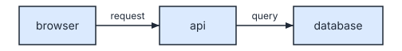

# Diagrams inside your pages

You can keep a diagram's spec in the Markdown page it belongs to. SVGDog then draws the picture and keeps the page pointing at it. The text and its diagram live in one file, so they are reviewed and changed together.

## Write the diagram in the page

Put the spec in a code block marked `svgdog`. This is a real one, taken from the source of this page:

```svgdog request-path
version: 1
diagram: flow
title: Request path
edges:
  - "browser -> api: request"
  - "api -> database: query"
```



Then run:

```bash
svgdog docs docs/
```

SVGDog draws each diagram into a `diagrams` folder next to the page and adds an image line under the block. The picture above was made this way; in the page source it is this line:

```markdown

```

Change the spec, run the command again, and the picture and the image line are updated. Running it when nothing changed writes nothing. The boxes that were already in the picture stay where they were; see [Changing a diagram without moving it](changing-a-diagram.md).

- The word after `svgdog` (`request-path` above) names the picture. Without it, diagrams are numbered in the order they appear on the page.
- The text in the square brackets is what readers get when the picture cannot be shown. SVGDog writes it from the spec's `title` and `description`.
- You can pass single files as well as folders: `svgdog docs README.md docs/`.

## Hide the source

A code block shows its YAML to your readers. If you want them to see only the picture, put the spec in a comment:

```markdown
<!-- svgdog request-path
version: 1
diagram: flow
title: Request path
edges:
  - "browser -> api: request"
-->
```

The opening `<!-- svgdog` and the closing `-->` must each be on a line of their own. The image line is added under the comment in the same way.

## One picture for light and dark pages

Sites such as GitHub show a page in the reader's light or dark mode. Ask for the theme that follows it:

```bash
svgdog docs docs/ --theme docs-auto
```

See [Themes and settings](themes-and-settings.md#light-dark-or-following-the-reader).

## Interactive versions

Add `--interactive html` and SVGDog also writes a small page for each diagram, next to its picture, and ends the image line with a link to it:

```markdown
 [Interactive version](diagrams/page-request-path.html)
```

The picture in your page stays an ordinary image, so it shows everywhere. The linked page lets the reader step through the diagram's `steps` (see [Explaining a diagram](explaining-a-diagram.md#let-the-reader-step-through-it)).

## Keep pictures from going stale

In a pull request check or other automation, add `--check`:

```bash
svgdog docs docs/ --check
```

It writes nothing. It exits with 1 and lists the files if a picture is missing, if a spec has changed since its picture was drawn, or if an image line is wrong. Use the same flags (`--theme`, `--assets`, `--interactive`) as when you drew the pictures.

For a spec kept in its own file there is a matching check:

```bash
svgdog render orders.yaml -o orders.svg --check
```

## Things to know

- Pictures go to `diagrams/` by default. Choose another folder with `--assets images`. Keep it for SVGDog alone: an image line under a diagram that points into this folder is treated as SVGDog's and replaced.
- If you delete or rename a diagram, its old picture stays on disk. Remove it yourself.
- A mistake in a spec stops the run, and the message names the page and the line where that diagram starts.

## Reading a diagram back

To get a diagram as words, for example to check alt text or to let an assistant read an existing figure:

```bash
svgdog describe orders.yaml --format text
```

This works on a spec file. It also works on an SVG if the SVG was drawn with `--embed-spec`, which stores the spec inside the picture so the source can always be recovered from it.
