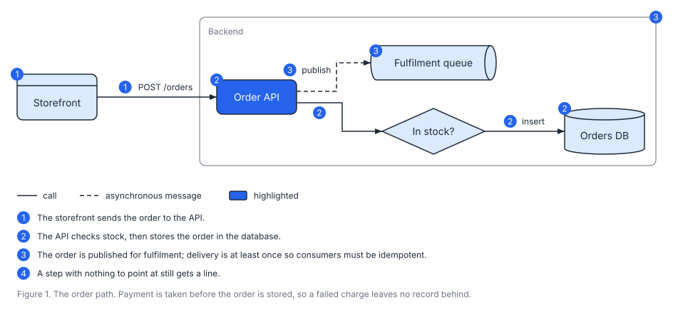
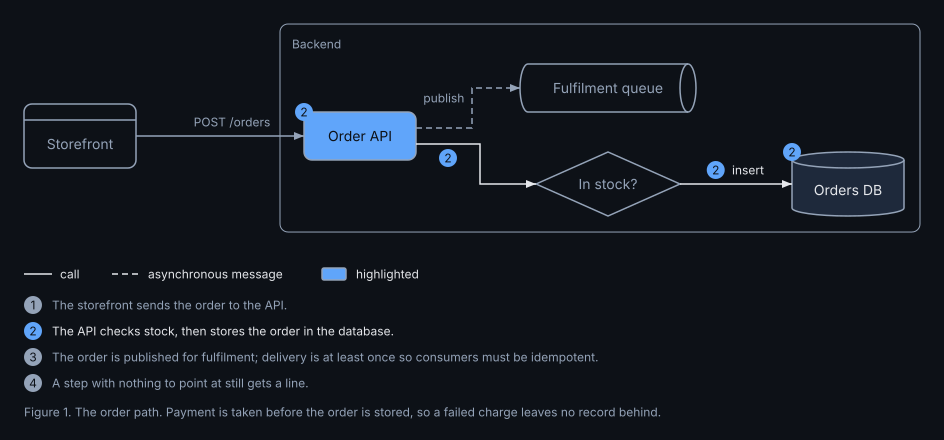

# Explaining a diagram

A diagram shows what exists. To explain something, you also need to say where to look and in what order. Four optional parts of a spec do that: steps, focus, a legend and a caption. This page shows each one.

## Steps: a numbered walk-through

Add a `steps` list. Each step is a sentence, plus the boxes, arrows or frames it is about.

```yaml
steps:
  - { text: The storefront sends the order to the API., show: [web, web--api] }
  - { text: "The API checks stock, then stores the order in the database.", show: [api, api--check, check--db, db] }
  - { text: The order is published for fulfilment., show: [api--queue, queue, backend] }
  - A step with nothing to point at still gets a line.
```

SVGDog numbers the steps, puts each number on the things that step shows, and lists the sentences under the drawing:



- To point at an arrow, use its `id`. An arrow without an id is called `from--to`, for example `web--api`.
- A box can belong to several steps; it then carries several numbers.
- Put quotes around a sentence that contains a colon or a comma inside `{ }`.
- A spec can have up to 20 steps. If you need more, split the story over two diagrams.

### One picture per step

For slides or a page that reveals the story bit by bit, ask for frames:

```bash
svgdog render orders.yaml -o orders.svg --frames
```

This writes `orders.1.svg`, `orders.2.svg` and so on. Each frame marks one step, keeps what it shows at full strength and dims the rest. Nothing moves between frames, so they can be shown one after another. This is frame 2 of the diagram above, in the dark theme:



### Let the reader step through it

Frames are separate pictures. For a single page where the reader clicks through the steps, ask for the interactive page:

```bash
svgdog render orders.yaml -o orders.html --interactive html
```

The page shows the drawing with Previous and Next buttons under it; the arrow keys work too. Choosing a step fades everything that step is not about. Clicking a box that has a `detail` shows the detail under the drawing. The page is one file with nothing to install, and it still shows the whole numbered diagram where scripts are switched off.

There is a lighter version with no script at all:

```bash
svgdog render orders.yaml -o orders.svg --interactive css
```

It is an ordinary SVG in which pointing at a box fades everything that is not connected to it, and pointing at a step in the list highlights what the step is about. This works when your site places the SVG directly into the page. Shown as a plain image, which is what Markdown's image syntax does on most sites including GitHub, it looks exactly like the normal picture.

To look at one step yourself, or to let an assistant check it, make a PNG of it:

```bash
svgdog preview orders.svg -o step2.png --step 2
```

## Focus: look here

`focus` dims everything except what you list, without numbering anything:

```yaml
focus: [api, db]
```

The listed boxes keep their colour, and so does the arrow between them. Naming a frame keeps everything inside it. Everything else stays in place but turns grey, so the reader still sees the context.

## A legend

`legend: true` adds a row under the drawing that explains the arrow styles and the emphasis colour, if the drawing uses them. To explain something else, write the entries yourself:

```yaml
legend:
  - { style: async, text: event }
  - { kind: datastore, text: storage }
  - { emphasis: true, text: changed in this release }
```

Each entry has a `text` and one of `style`, `kind` or `emphasis: true`.

## A caption

`caption` is a line of text drawn under everything else:

```yaml
caption: Figure 1. The order path.
```

Use it for what a figure caption usually says. The `title` and `description` are different: they are not drawn, they are what screen readers announce.

## Details and links

Any box, arrow or frame can carry a `detail` and a `link`:

```yaml
nodes:
  - { id: api, label: Order API, detail: Owns the order lifecycle., link: "https://example.com/docs/orders" }
```

- `detail` appears as a tooltip when the reader hovers over the item, where the page allows it.
- `link` makes the item clickable. It can be a web address, a `mailto:` address or a path to another page of your documentation.

Both work when the SVG is placed in a page directly or opened on its own. A page that shows the SVG as a plain image (which is what Markdown image syntax does on most sites) shows the picture but ignores tooltips and clicks.
