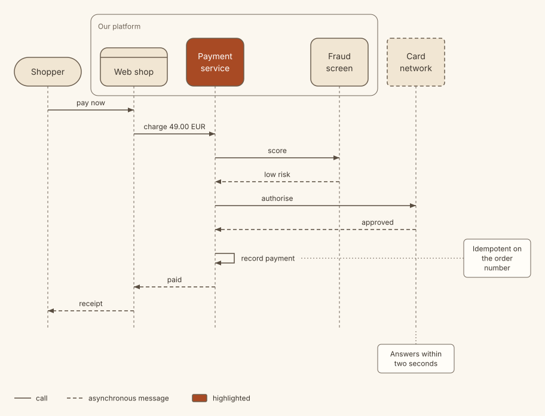
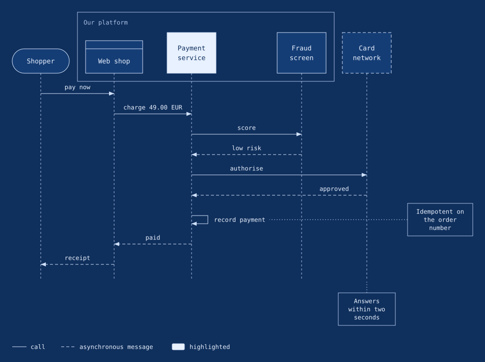

# Sequence gallery

This page shows three sequence diagrams, each with the spec that draws it, and then one of them in two other themes. Copy the one closest to your case and change the names. It takes about five minutes. For the full rules, see [Diagram types](diagram-types.md#sequence).

Every picture here is drawn with `svgdog render`, for example:

```bash
svgdog render cache.yaml -o cache.svg
```

## A request that may skip a step

A cache sits in front of a database. The solid arrows are calls and the dashed arrows are replies. Messages run from top to bottom in the order you list them, so write them in the order they happen.

<!-- spec: sequence-cache -->
```yaml
version: 1
diagram: sequence
title: Reading a profile through a cache
description: A request for a profile is answered from the cache when it can be, and from the database when it cannot.
caption: Only a cache miss reaches the database.
nodes:
  - { id: browser, label: Browser, kind: client }
  - { id: api, label: Profile API, kind: service }
  - { id: cache, label: Cache, kind: datastore }
  - { id: db, label: Database, kind: datastore }
edges:
  - { id: get, from: browser, to: api, label: "GET /profile/42" }
  - { id: lookup, from: api, to: cache, label: lookup }
  - { id: miss, from: cache, to: api, label: miss, style: async }
  - { id: query, from: api, to: db, label: select profile }
  - { id: row, from: db, to: api, label: row, style: async }
  - { id: store, from: api, to: cache, label: store for 5 min, style: async }
  - { id: ok, from: api, to: browser, label: 200 OK, style: async }
```


## Frames, notes, a self-message and a legend

This one uses most of what a sequence diagram can show: a frame around the parts you own, a message from a participant to itself, notes on a message and on a participant, a highlighted participant, and a legend.

<!-- spec: sequence-payment -->
```yaml
version: 1
diagram: sequence
title: Card payment
description: A shop asks its payment service to charge a card, which checks with the card network and the fraud screen.
legend: true
nodes:
  - { id: shopper, label: Shopper, kind: actor }
  - { id: shop, label: Web shop, kind: client }
  - { id: pay, label: Payment service, kind: service, emphasis: true }
  - { id: fraud, label: Fraud screen, kind: service }
  - { id: network, label: Card network, kind: external }
groups:
  - { id: platform, label: Our platform, members: [shop, pay, fraud] }
edges:
  - { id: submit, from: shopper, to: shop, label: pay now }
  - { id: charge, from: shop, to: pay, label: charge 49.00 EUR }
  - { id: score, from: pay, to: fraud, label: score }
  - { id: low, from: fraud, to: pay, label: low risk, style: async }
  - { id: auth, from: pay, to: network, label: authorise }
  - { id: approved, from: network, to: pay, label: approved, style: async }
  - { id: record, from: pay, to: pay, label: record payment }
  - { id: paid, from: pay, to: shop, label: paid, style: async }
  - { id: thanks, from: shop, to: shopper, label: receipt, style: async }
notes:
  - { attach: record, text: Idempotent on the order number }
  - { attach: network, text: Answers within two seconds }
```

![A sequence diagram titled Card payment. Five lifelines: Shopper, Web shop, Payment service, Fraud screen and Card network. The web shop, payment service and fraud screen sit in a frame labelled Our platform. The shopper pays, the shop asks the payment service to charge 49.00 EUR, the service gets a low risk score from the fraud screen, is approved by the card network, records the payment in a message to itself, and answers paid back to the shop and a receipt to the shopper. A legend explains the solid and dashed arrows and the highlighted box.](images/sequence-payment.svg)

## A walk-through

Add `steps` and each step gets a number. The numbers appear on the participants and messages the step shows, and the sentences are listed under the picture. Use it when you want a reader to follow the story one part at a time.

<!-- spec: sequence-deploy -->
```yaml
version: 1
diagram: sequence
title: Releasing a service
description: A merged change is built, tested and rolled out to the cluster.
caption: The rollout waits for the health check before it moves on.
nodes:
  - { id: dev, label: Developer, kind: actor }
  - { id: ci, label: CI, kind: service }
  - { id: registry, label: Registry, kind: datastore }
  - { id: cluster, label: Cluster, kind: external, emphasis: true }
edges:
  - { id: merge, from: dev, to: ci, label: merge to main }
  - { id: build, from: ci, to: ci, label: build and test }
  - { id: push, from: ci, to: registry, label: push image }
  - { id: roll, from: ci, to: cluster, label: start rollout }
  - { id: pull, from: cluster, to: registry, label: pull image }
  - { id: health, from: cluster, to: cluster, label: health check }
  - { id: done, from: cluster, to: ci, label: rollout complete, style: async }
  - { id: notify, from: ci, to: dev, label: released, style: async }
steps:
  - { text: A merge starts the pipeline., show: [dev, ci, merge] }
  - { text: CI builds the change and stores the image., show: [build, push, registry] }
  - { text: The cluster pulls the image and checks its health., show: [roll, pull, health, cluster] }
  - { text: The developer hears that the release is out., show: [done, notify] }
```


## The same conversation in other themes

Only the theme changes. The card payment from above, in `paper` and in `blueprint-dark`:

```bash
svgdog render payment.yaml -o payment.svg --theme paper
svgdog render payment.yaml -o payment.svg --theme blueprint-dark
```





To see every theme, go to the [Theme gallery](theme-gallery.md). For the other diagram types, see [Galleries](galleries.md).

## Tips

- List the nodes in the order you want the lifelines, left to right. Put the one that starts the conversation first.
- Give each edge an `id` when a note or a step needs to point at it, and when two messages join the same pair of nodes.
- Use `style: async` for replies and fire-and-forget messages.
- Use a self-message (`from` and `to` the same node) for work a participant does by itself.
- If the picture gets too wide, shorten the labels or use fewer participants. Split a long conversation into two diagrams.
