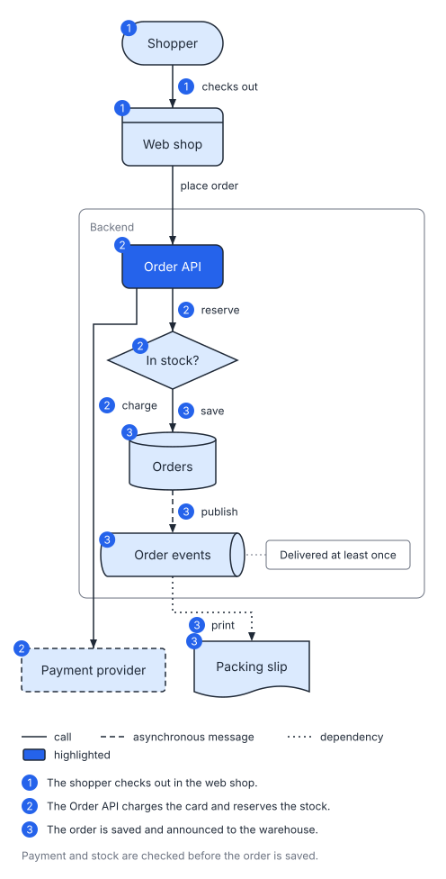
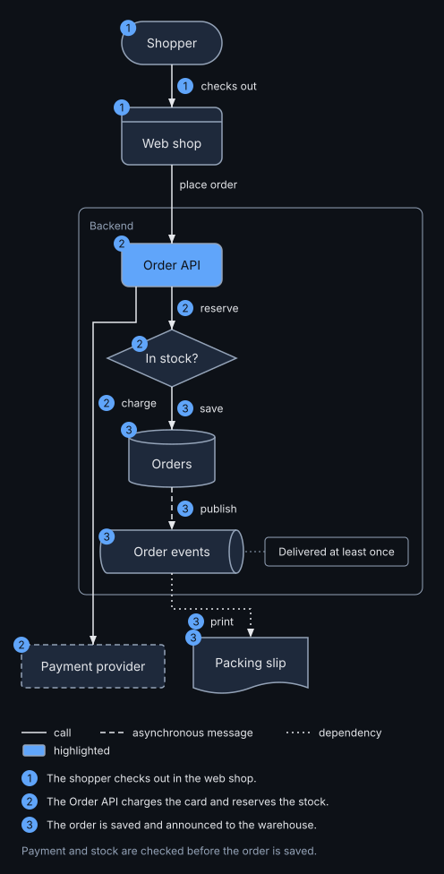
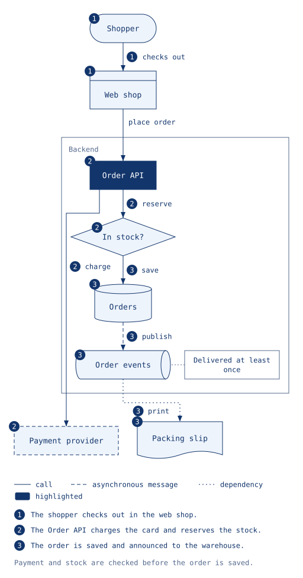
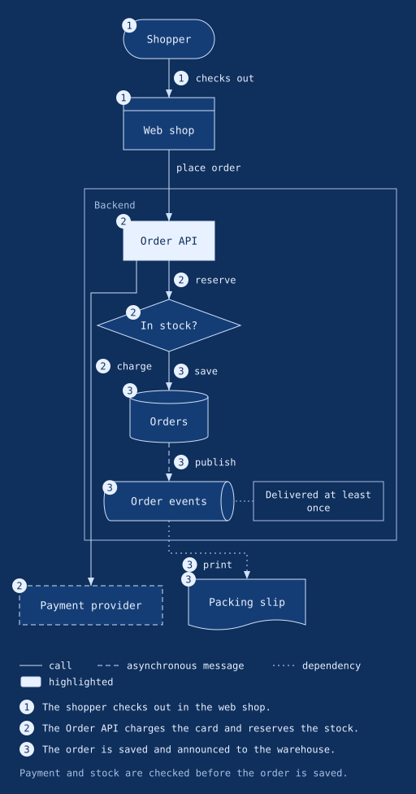
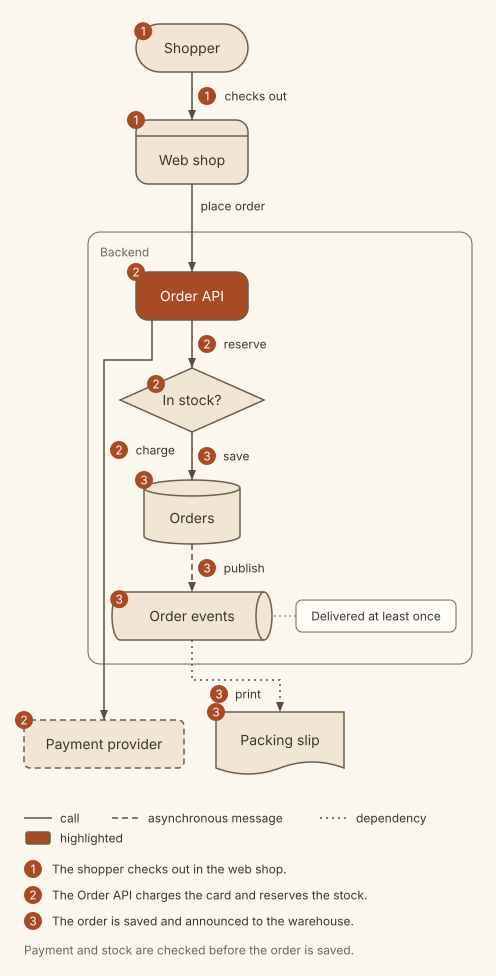
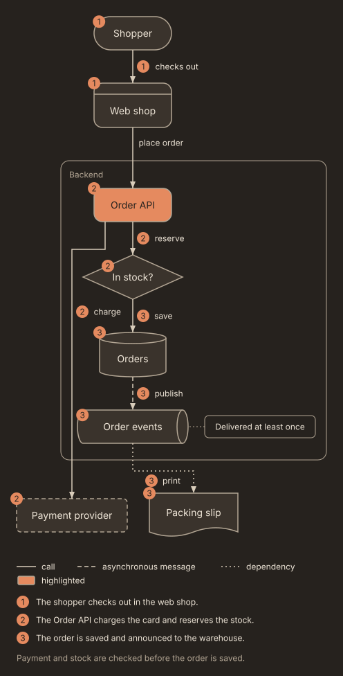
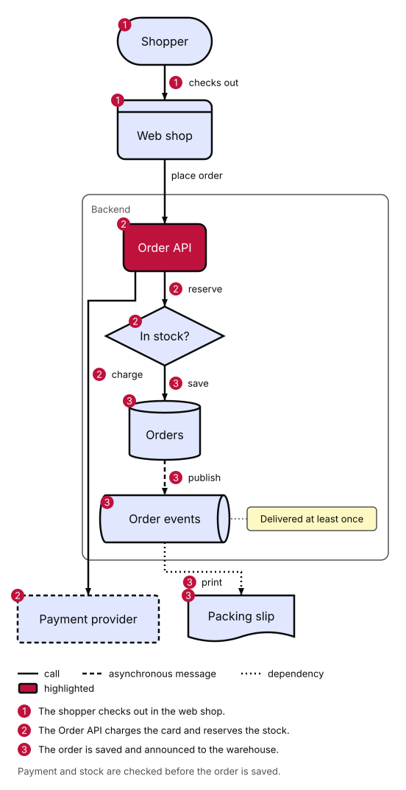
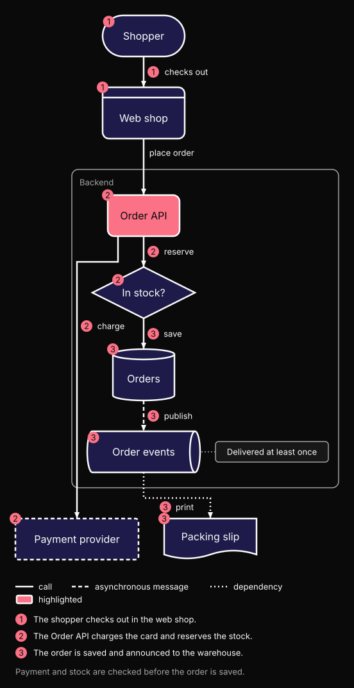
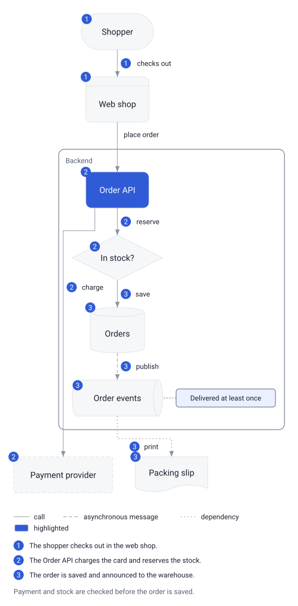
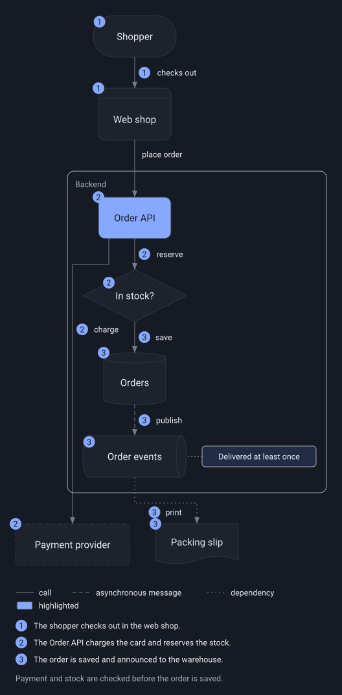

# Theme gallery

This page shows one diagram drawn in every built-in theme, in the light and the dark variant, so you can pick a look by eye. It takes about five minutes. To use a theme, see [Themes and settings](themes-and-settings.md#choosing-a-theme).

## The diagram

Every picture below comes from the same spec. It uses most of what a theme styles: the common node kinds, a frame, a highlighted box, the three arrow styles, a note, numbered steps, a legend and a caption.

```yaml
version: 1
diagram: flow
direction: down
title: Placing an order
caption: Payment and stock are checked before the order is saved.
legend: true
nodes:
  - { id: shopper, label: Shopper, kind: actor }
  - { id: shop, label: Web shop, kind: client }
  - { id: api, label: Order API, kind: service, emphasis: true }
  - { id: pay, label: Payment provider, kind: external }
  - { id: stock, label: In stock?, kind: decision }
  - { id: orders, label: Orders, kind: datastore }
  - { id: events, label: Order events, kind: queue }
  - { id: slip, label: Packing slip, kind: document }
groups:
  - { id: backend, label: Backend, members: [api, stock, orders, events] }
edges:
  - "shopper -> shop: checks out"
  - "shop -> api: place order"
  - "api -> pay: charge"
  - "api -> stock: reserve"
  - "stock -> orders: save"
  - "orders --> events: publish"
  - "events ..> slip: print"
notes:
  - { attach: events, text: Delivered at least once }
steps:
  - { text: The shopper checks out in the web shop., show: [shopper, shop, shopper--shop] }
  - { text: The Order API charges the card and reserves the stock., show: [api, pay, stock, api--pay, api--stock] }
  - { text: The order is saved and announced to the warehouse., show: [orders, events, slip, stock--orders, orders--events, events--slip] }
```

Only the theme changes from one picture to the next:

```bash
svgdog --format text render showcase.yaml -o showcase.svg --theme paper-dark
```

Each theme also has an `-auto` variant, which is the light picture with a rule that switches to the dark colours when the reader's system is in dark mode.

## docs

The default. Quiet blue and grey, Inter at 14 px, lines 1.5 px thick. Made for documentation pages.

`--theme docs`



`--theme docs-dark`



## blueprint

An engineering drawing: fine 1 px lines, square corners and a monospace font. The dark variant is pale lines on blue paper.

`--theme blueprint`



`--theme blueprint-dark`



## paper

A warm cream page with soft ink, a terracotta accent and well-rounded corners. Made for handbooks and long reads.

`--theme paper`



`--theme paper-dark`



## bold

Larger text (16 px), thick lines and strong contrast. Made for slides and screens seen from a distance.

`--theme bold`



`--theme bold-dark`



## cards

Soft grey cards with hairline borders, round corners and a blue accent, in the reader's system font. Made for product and landing pages.

`--theme cards`



`--theme cards-dark`



## What to notice

- **Text size changes the layout.** `bold` and `cards` use larger text, so their boxes and the whole picture are larger. `blueprint` uses a monospace font, which makes labels wider.
- **Corners and lines do not.** `docs` and `paper` have the same text sizes, so their boxes are in the same places; only colours, corners and line widths differ.
- **`cards` has very light outlines.** Its boxes are told apart from the page by a hairline and a pale fill. It suits a page that is mostly looked at; for diagrams that must be read by everyone, in print or on a poor screen, prefer `docs` or `bold`.

None of these is quite right? [Make your own theme](making-a-theme.md), starting from the closest one.
