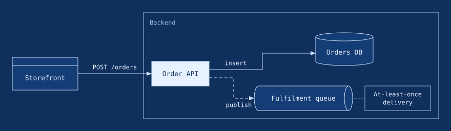
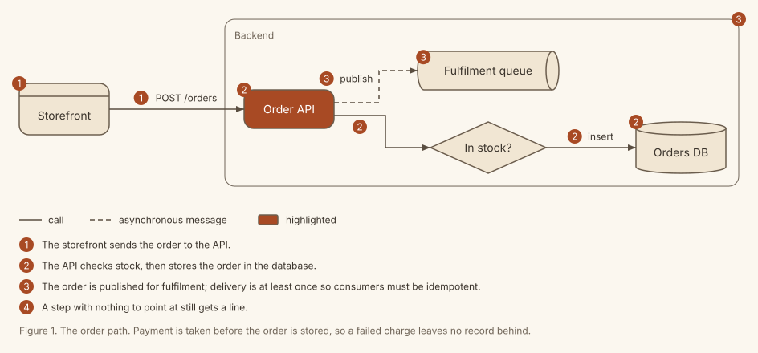
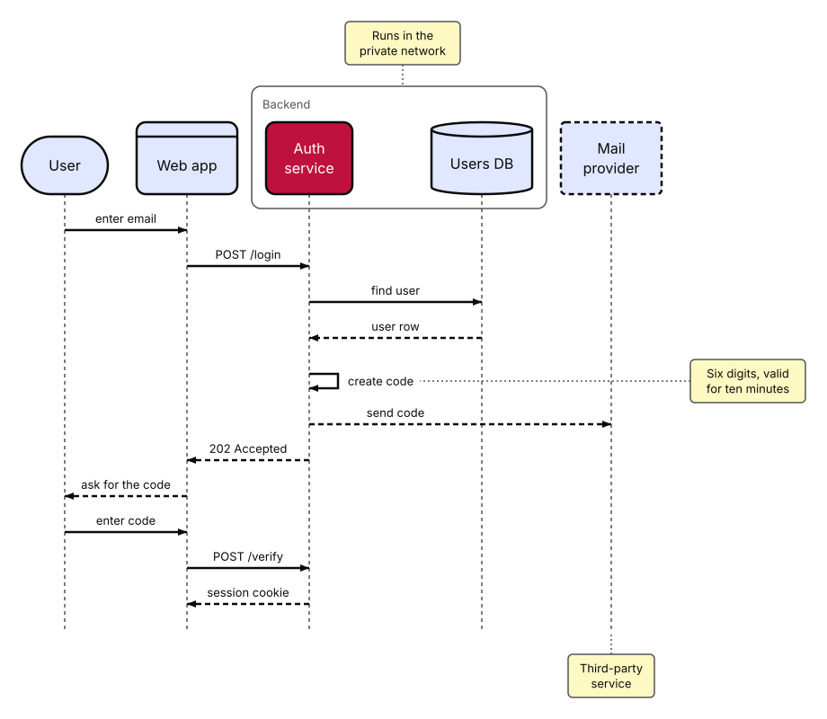

# Themes and settings

This page shows how to change how diagrams look and how to set house rules for a whole project. It takes about ten minutes.

## Themes

A theme sets the whole look of a diagram: its colours, its font and text sizes, how thick the lines are and how round the corners. SVGDog has four built-in themes:

| Theme | Look | Good for |
|---|---|---|
| `docs` | Quiet blue and grey, Inter, 14 px text. This is the default | Documentation pages |
| `blueprint` | Fine blue lines, square corners, a monospace font | Technical drawings and architecture notes |
| `paper` | Warm cream page, soft ink, a terracotta accent, well-rounded corners | Handbooks, blog posts and long reads |
| `bold` | Larger text (16 px), thick lines, strong contrast | Slides and screens seen from a distance |

List them, with their descriptions, at any time:

```bash
svgdog --format text theme list
```

The same diagram in `blueprint-dark`, `paper` and `bold`:







### Light, dark, or following the reader

Every built-in theme has three variants. Add the ending to the name:

- `paper` or `paper-light`: the light variant.
- `paper-dark`: the dark variant.
- `paper-auto`: one file that follows the reader. It is the light drawing, with a rule inside that switches to the dark colours when the reader's system is in dark mode.

The default is `docs-light`.

Use an `-auto` variant when the same page is read in light and dark mode, for example a README. It works wherever a browser shows the SVG, including as a plain image. A viewer that does not understand the rule shows the light version, and so does `svgdog preview`. To see the dark version, render once with the `-dark` variant.

### Choosing a theme

There are three places to name a theme. The first one that is set wins:

1. On the command line, for a single run:

   ```bash
   svgdog --format text render hello.yaml -o hello.svg --theme paper-dark
   ```

2. In the spec, for one diagram:

   ```yaml
   theme: blueprint
   ```

3. In `svgdog.toml`, for every diagram in the project that does not name one:

   ```toml
   [style]
   theme = "paper-auto"
   ```

A theme with larger or wider text makes larger boxes. If a diagram no longer fits its `max_width`, SVGDog says so; shorten a label, use `direction: down` or raise `max_width`. When you change the theme of a picture that already exists, add `--previous` to keep the boxes where they were (see [Changing a diagram without moving it](changing-a-diagram.md)).

To match your own house style, write a theme of your own: see [Making your own theme](making-a-theme.md).

## Text as outlines

By default the picture keeps its text as real text, so it can be searched, selected and read by screen readers. If you need the picture to look exactly the same in programs that lack the Inter font, ask for outlines:

```bash
svgdog --format text render hello.yaml -o hello.svg --text-as-paths
```

The result looks the same everywhere but the words can no longer be searched or read aloud, so prefer the default.

## House rules: svgdog.toml

A project can keep its settings in one file called `svgdog.toml`. SVGDog looks for it in the folder of the file you check, then in each folder above it, and uses the nearest one. When it finds one, it prints a line such as `svgdog: config /path/to/svgdog.toml` to the error output.

```toml
version = 1
profile = "docs"                 # minimal, docs or strict

[target]
render_width = 720               # px the diagram is shown at
backgrounds = ["light", "dark"]

[style]
palette = ["#1f2937", "#ffffff", "#2563eb", "#dbeafe", "#6b7280"]
stroke_widths = [1, 1.5, 2]
grid = 8

[rules]
excess-margin = "off"
font-too-small = { severity = "error", min_px = 10 }
```

What the parts mean:

- `profile`: how strict the checks are (see below).
- `[target]`: how big the diagram will be shown, and on which page colours. Rules about text size and contrast use these numbers.
- `[style]`: `theme` is the project's theme (see above). `palette`, `stroke_widths` and `grid` are the colours, line widths and grid your project allows; colours outside the palette are reported. When you set a palette, list the colours of your theme in it.
- `[rules]`: switch a rule `"off"`, or change its severity or limits.

To ignore the file for one run, add `--no-config`. To use a specific file, add `--config path/to/svgdog.toml`. Every setting is described in the [Operator guide](../operator/).

## Profiles: how strict to be

| Profile | What it checks | When to use it |
|---|---|---|
| `minimal` | Only whether the file is valid and safe (structure rules, scripts, external resources) | Pictures from other tools that you cannot change |
| `docs` | Everything, at each rule's normal severity | The default; good for documentation |
| `strict` | Everything, with every level raised one step: info becomes warning, warning becomes error | Releases and shared style libraries |

Set a profile in `svgdog.toml` or per run with `--profile strict`. On the broken example file the three profiles report 3 errors (`minimal`), 7 errors (`docs`) and 10 errors (`strict`).
